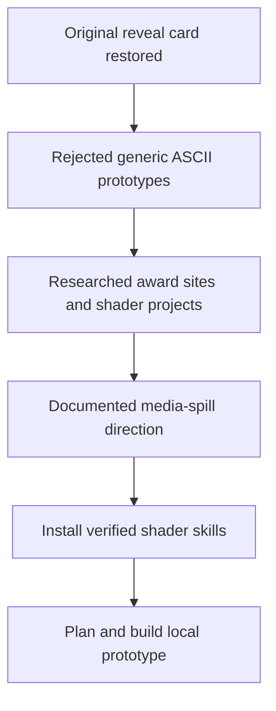

## What

- Reverted and removed the rejected local ASCII/dither prototype.
- Confirmed production remains on the original homepage hero.
- Researched award-site dithering, morphing ASCII, halftone WebGL and WebGPU particle references.
- Evaluated available agent skills using install counts, repository reputation, documentation and licensing.
- Wrote the complete findings to `docs/experiments/001-homepage-visual-direction/findings/01-visual-research.md`.

## Key Takeaways

- High-quality dither/ASCII work transforms meaningful source media; it does not use unrelated procedural noise as decoration.
- The recommended concept is a media spill derived from the existing wave artwork while preserving `CoverReveal` unchanged.
- Ordered Bayer dithering is stable for animation; error diffusion crawls and shimmers.
- Sobel edge glyphs, temporal memory and SDF glyph morphing are the main techniques needed to retain shape and avoid flicker.
- Best skill source: `cloudai-x/threejs-skills` with 4,327 GitHub stars and 20K+ installs per relevant skill.

## Current State

- Branch: `master`.
- Production: original hero is live; no experimental shader is deployed.
- Working tree: only new documentation scaffolding under `docs/architecture`, `docs/experiments`, `docs/guides`, `docs/learnings` and `docs/research` is untracked.
- Active experiment: `1` (`001-homepage-visual-direction`).
- Active finding: `docs/experiments/001-homepage-visual-direction/findings/01-visual-research.md`.
- Build was previously passing before the rejected prototype was removed.
- No skill has been installed yet.

## Issues

- Existing R2 wave asset does not currently return an `Access-Control-Allow-Origin` header, so a shader cannot safely sample it as a cross-origin texture without changing R2 CORS or serving an optimized UI texture from the site.
- Temporary public tunnels were unreliable and expired; future review should use a local GIF/video/contact sheet before production.
- Previous attempts failed because they used static text/CSS scanlines or unrelated procedural glyph fields.

## Decisions

- Preserve the current image, profile reveal card, social links and hero copy.
- Build one hero-only media effect rather than a page-long background.
- Use the wave artwork as the source subject and extend it outside the card through dither/ASCII rendering.
- Do not push future prototypes before visual review.
- Prefer verified, popular skills over low-install "creative WebGL" skills.

## Inferred Priority

**Inferred:** install the verified shader/ASCII skills, then create an implementation plan for a texture-backed media-spill prototype before writing production code.

## Next

1. Install the recommended skills:
   ```bash
   npx skills add cloudai-x/threejs-skills@threejs-shaders -g -y
   npx skills add cloudai-x/threejs-skills@threejs-postprocessing -g -y
   npx skills add iart-ai/web-animation-skills@ascii-animation -g -y
   npx skills add iart-ai/webgl-animation-skills@shader-glsl -g -y
   ```
2. Restart the agent session so newly installed skills are loaded.
3. Resume experiment 1:
   ```bash
   bash /Users/sagar/.agents/skills/doc/scripts/resume.sh 1
   ```
4. Create a plan with `/doc plan 1 "media-spill-prototype"`.
5. Resolve texture access by either configuring R2 CORS or creating a local optimized UI texture; do not modify Markdown image conventions.
6. Build the prototype locally around `src/components/CoverReveal.tsx` and `src/app/(site)/page.tsx`, keeping `CoverReveal` itself intact.
7. Verify at 1440, 1024, 768 and 390 pixels, plus light/dark/reduced-motion/WebGL-failure states.
8. Produce a deterministic recording/contact sheet for approval before any commit or production push.
