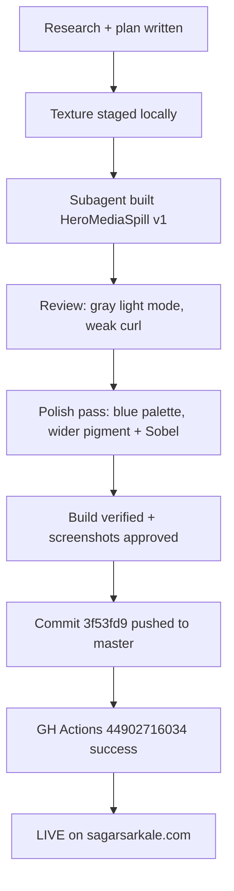

## What

- Media-spill hero v1 built and **deployed to production** via subagent (gpt-6-astra, medium).
- New: `src/components/HeroMediaSpill.tsx`, `public/textures/wave-spill.jpg`;
  modified: hero section of `src/app/(site)/page.tsx` only. `CoverReveal.tsx` untouched.
- Docs committed: plan 01, findings 01–02, checkpoints 01–02 under `docs/experiments/001-*`.
- Live verified: texture 200, homepage references spill, deploy run succeeded.

## Key Takeaways

- Raw WebGL2 single-pass shader was sufficient — no three.js needed for v1.
- R2 bucket lacks CORS headers → shader textures must be same-origin; local
  `public/textures/wave-spill.jpg` (from the 1200×630 R2 og-image) sidesteps it entirely.
- Light-mode palette broke because `--fg` is near-black: mixing pigment toward `u_fg`
  grays it out. Pigment must stay blue; theme integration ≠ fg mixing.
- First-art-pass critique loop (screenshot → steer → re-capture) took one iteration to fix
  both issues; dark mode was right on pass 1.

## Current State

- Branch `master` @ `3f53fd9`, pushed; working tree clean.
- Production: https://sagarsarkale.com serves v1 (desktop spill + mobile band).
- Active experiment: 1. Active finding: `findings/02-media-spill-v1.md`.
- `gh` CLI: active account switched to `sagarsrc` (was `sagar-sarkale-cmul8`, 403 on push).
- Old dev server still running on port 4174 (leftover; harmless).

## Issues

- Push initially 403'd — wrong gh account; fixed with `gh auth switch --user sagarsrc`.
- Curl silhouette weak at 1024 px (documented in finding 02).
- Skills were installed with `-g` to `~/.agents/skills/`, so this session didn't have them
  in-context; subagent read them from disk instead. Fine, but a fresh session loads them.

## Decisions

- Ship v1 after one polish iteration rather than holding for perfect curl legibility —
  user asked for prod; v1 meets all hard acceptance criteria.
- Keep R2 og-image hotlink for the mobile strip (unchanged); only the shader uses the local texture.
- Docs committed alongside code (docs/ is tracked in this repo).

## Inferred Priority

**Inferred:** v2 art pass on curl legibility at narrow widths (cell variance / denser contour
band near the card), then a perf check (`threejs-performance` skill) before calling the
experiment done. Also consider removing the leftover dev server on 4174.

## Next

1. Look at prod on a real phone + narrow desktop; decide if curl legibility needs v2.
2. If yes: steer on `HeroMediaSpill.tsx` fragment shader — contour band density near card
   edge, cell size variance; re-capture at 1024; commit; push.
3. Run a perf pass: DPR behavior on low-end mobile, texture memory (single 1200×630 RGBA
   ≈ 3 MB), RAF cost at rest.
4. Experiment close-out: write final review (`/doc review 1 "media-spill-v1"`) once v2 or
   accept-v1 decision is made.
5. Kill stale dev server: `lsof -ti:4174 | xargs kill`.
