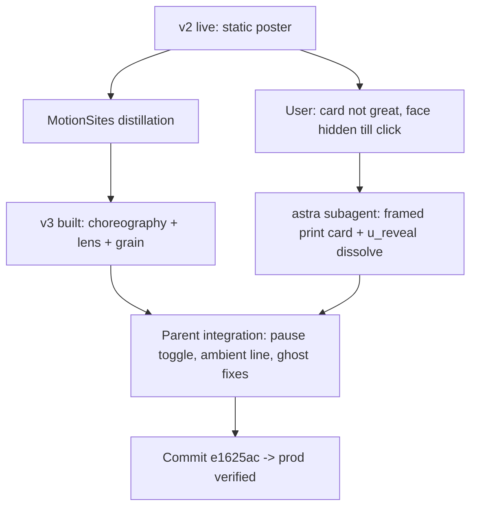

## What

- v3 "motion identity" hero shipped: staged entrance, scroll drift/fade +
  Ken Burns field, pointer develop-lens, `u_reveal` whole-sheet dissolve,
  framed-print card (face hidden until click), print grain, sāgara ghost.
- leo.here touches: header `pune · HH:MM` IST line, footer colophon + "still
  the wave" motion toggle (persisted).
- Branch `master` @ `e1625ac`, clean tree, deploy success, live verified.

## Key Takeaways

- Content fade must COMPLETE before the hero leaves the viewport — mid-scroll
  translucency over a busy field reads as a rendering bug, not choreography.
- Turbopack caches broken CSS output: if dev shows a stale PostCSS error while
  files are clean, `rm -rf .next` + restart (build was never affected).
- astra (openai-codex) usage limit resets after roughly an hour; resume keeps
  full context across limits — 3rd resume did the best work of the session.

## Current State

- Prod: https://sagarsarkale.com serving v3. Experiment 1 active.
- Active docs: plan 03, findings 01–03, checkpoints 01–03.
- Dev server: fresh instance on 4174 (`.next` purged this session).
- Capture scripts: `/tmp/media-spill/capture.cjs`, `capture-v3.cjs` (scrolled,
  lens, reveal states).

## Issues

- Dark-mode card mat is the dark surface color — frame reads heavier than
  light mode (agent-noted nit; user hasn't seen it yet — watch for feedback).
- `sāgara` desktop-only for now; a mobile placement (top band) is possible if
  the user misses it.
- Dev-only: `react-grab` CORS console noise, pre-existing, unrelated.

## Decisions

- Card keeps wave-first/click-for-face toggle (user's words, decoded as
  keeping existing semantics with the face as the climactic reveal).
- "Still the wave" freezes animation in place rather than swapping to poster —
  resume is instant, no state machine needed.
- Ambient line is IST-clock-only (no weather API) — zero network dependency.

## Inferred Priority

**Inferred:** user review of v3 on real devices (esp. dark mode card weight,
scroll feel, the reveal dissolve). Then either micro-tweaks (mat contrast,
scroll curve) or experiment close-out with `/doc review 1 "hero-v3"`.

## Next

1. Ask user for device pass feedback; watch for dark-mode mat and scroll-ghost
   comments.
2. If dark mat flagged: lighten mat toward `color-mix(in srgb, var(--surface)
   80%, var(--fg))` or add a hairline highlight ring.
3. Optional: mobile `sāgara` placement in the top artwork band (font-size
   ~64px, opacity 0.12, above the panel).
4. Close-out: `/doc review 1 "hero-v3-final"` when user approves; kill the
   4174 dev server.
