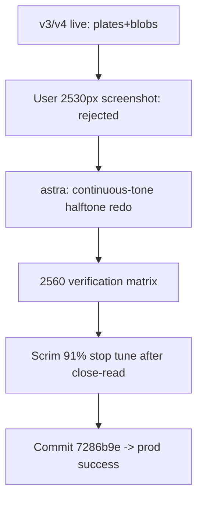

## What

- v5 shipped: field is now a true clustered-dot halftone of the wave
  (Bayer 8×8, density→dot radius), viewport-scaled cells, 2400px source,
  gradient scrim instead of panel, frosted social chip.
- Branch `master` @ `7286b9e`, tree clean, deploy success, live.
- Docs through finding 04 / checkpoint 04.

## Key Takeaways

- Posterized plates are a small-screen illusion — any quantized-flat look must
  be verified at the user's real width (here 2530) before shipping.
- Continuous-tone ordered dither (`step(bayer, density)` + radius ramp) is the
  robust look: it degrades gracefully at every scale.
- Scrim gradients need a close-read crop at max width; a 5% stop difference
  (86→91) is the line between "dots ghosting through text" and clean.

## Current State

- Prod serves v5. All v3 machinery intact (choreography, lens, reveal
  dissolve, pause, sāgara, fallbacks).
- Capture scripts in /tmp (ephemeral) — lineage noted in finding 04.
- Dev server on 4174 running, `.next` clean.

## Issues

- /tmp capture scripts are ephemeral; if the machine restarts they're gone.
  Rewrite into `scripts/capture-hero.cjs` if iteration continues.
- Dark-mode card mat weight nit from v4 still unreviewed by user.
- The astra subagent (fb3c8c00-bf97-48f) is at 20% context after 4 resumes —
  usable for a while longer, but a fresh agent with the docs can pick up.

## Decisions

- Card frozen this iteration per explicit user instruction.
- Halftone over glyphs/plates chosen as the durable look (scale-invariant).

## Inferred Priority

**Inferred:** user device pass at full width. If approved, close the
experiment (`/doc review 1 "hero-v5-final"`); optional polish only if flagged
(card mat in dark, curl legibility, scroll feel).

## Next

1. Get user verdict at 2530px, light + dark.
2. If good: write final review, mark experiment complete, consider
   `scripts/capture-hero.cjs` permanent + kill 4174 dev server.
3. If tweaks: small shader param edits only — do NOT restructure the tone
   pipeline again; it's sound.
