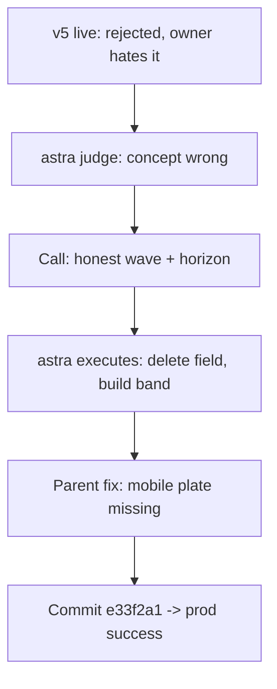

## What

- v6 live: quiet editorial hero + `WaveHorizon` band. Field-era code deleted.
- `master` @ `e33f2a1`, tree clean, deploy success, live verified.
- Docs through finding 05 / checkpoint 05, plan 04.

## Key Takeaways

- Owner's taste = restraint + one crafted moment. v1 too timid, v2–v5 too
  loud, v6 (quiet + one living line) is the register.
- astra judge-mode (screenshots in, brutal critique out) was the turning point
  — worth the tokens before building.
- Mobile parity check is the parent's job: the agent deleted the strip and
  left the plate desktop-only; the wave vanished from mobile until caught.

## Current State

- Prod serves v6. Remaining from field era: entrance keyframes, AmbientLine,
  pause toggle (now freezes the band), framed-card CSS, CoverReveal.
- Deleted but recoverable from git: all v3–v5 field machinery.

## Issues

- Horizon band is decorative-only on WebGL failure (CSS line) — acceptable.
- At 2560 the hero container is still `max-w-3xl` (narrow island of content in
  wide whitespace) — reads intentional now; revisit only if owner flags it.
- astra agent at ~25% context; still resumable, but a fresh agent + these docs
  can continue equally well.

## Decisions

- Field approach abandoned permanently (not param-tuned again).
- Card kept honest (no abstraction); wave first, click reveals face.
- Wave plate on mobile after socials (not before bio — CTA priority).

## Inferred Priority

**Inferred:** owner verdict on v6. If good → close experiment
(`/doc review 1 "hero-v6-final"`), kill 4174 dev server. If tweaks → they
should be small (spacing, band amplitude, plate size) — do not re-introduce
background effects without explicit owner request.

## Next

1. Get owner verdict (light + dark, desktop + phone).
2. On approval: final review doc, experiment complete.
3. On tweaks: single-parameter edits only; verify at 2560 first, always.
