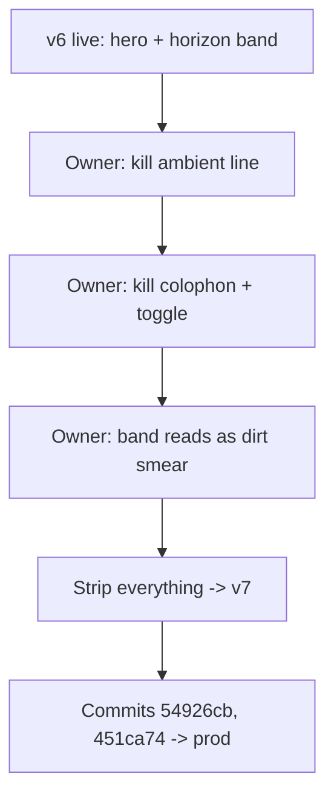

## What

- Homepage is final-stripped: framed wave plate + text + whitespace only.
- All hero-effect code deleted (WaveHorizon, AmbientLine, footer toggle,
  texture asset). `master` @ `451ca74`, deploy success, live verified.
- Docs through finding 06 / checkpoint 06.

## Key Takeaways

- Owner's final taste: ZERO decorative machinery. The wave image + words
  carry the entire design.
- Retina zoom is a test every effect must survive: subtle dithered lines
  become dirt smears at 2x devicePixelRatio.
- Do not re-add: background effects, ambient metadata, footer gimmicks —
  unless the owner explicitly asks.

## Current State

- Hero: clean `--bg`, text left, framed plate right (desktop w-72), mobile
  plate after socials (w-52). Entrance stagger (hero-rise keyframes) is the
  only motion. CoverReveal toggle unchanged.
- Deleted but recoverable from git history: all field/horizon/ambient code
  (v1–v6), `public/textures/wave-spill.jpg`.

## Issues

- None open. Site is simpler than at experiment start.

## Decisions

- Experiment effectively closed by owner feedback pattern; no review
  ceremony unless the owner wants one.

## Inferred Priority

**Inferred:** leave the homepage alone. If the owner wants polish later,
candidates: plate size/spacing micro-tuning, dark-mode mat weight — nothing
that adds elements.

## Next

1. Confirm owner satisfaction; if yes, stop touching the homepage.
2. Kill the 4174 dev server when the session winds down
   (`lsof -ti:4174 | xargs kill`).
3. Future motion/art experiments belong on OTHER pages or a sandbox route,
   never again bolted onto this homepage without owner sign-off on a
   screenshot first.
