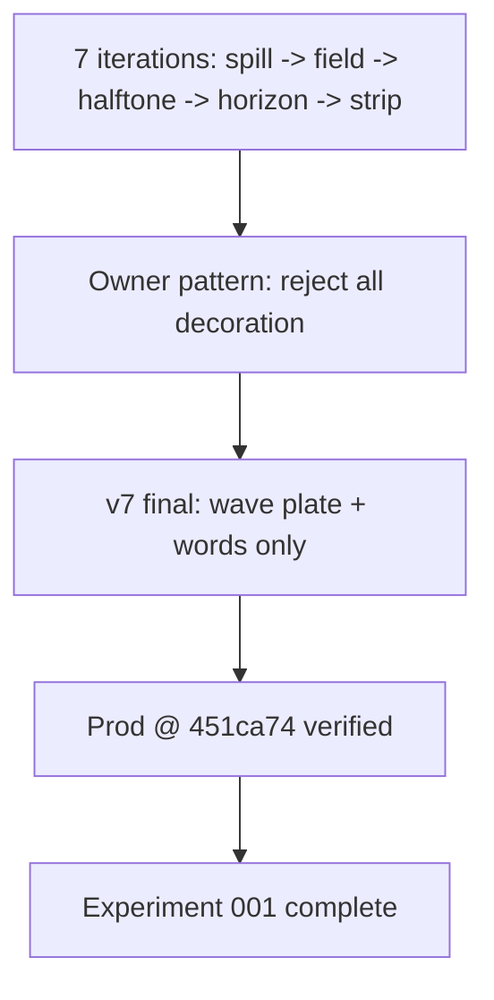

## What

Session wrap for experiment 001 (homepage-visual-direction). Seven shipped
iterations in one session, ending at the stripped editorial hero. Full
narrative: findings 01–06, checkpoints 01–06, plans 01–04.

## Key Takeaways

- Owner's taste, empirically established: the wave artwork + typography ARE
  the design. Rejected in order: timid side-spill, full-bleed abstract field,
  posterized plates, continuous-tone halftone field, horizon band, ambient
  time chip, colophon/pause toggle. Survivors: framed wave plate, serif-italic
  headline, entrance stagger, click-to-reveal face.
- Process lessons: verify at the owner's real viewport (2530px retina) BEFORE
  shipping; retina zoom turns subtle dither lines into dirt smears; judge-mode
  subagent critique before building beats iterating blind.
- Infra: push needs `gh auth switch --user sagarsrc`; deploy = push to master
  → GH Actions → GitHub Pages; Turbopack stale CSS errors clear with
  `rm -rf .next`.

## Current State

- `master` @ `0453511` (docs commit), working tree clean, prod verified.
- Homepage final: `src/app/(site)/page.tsx` hero (framed plate w-72 desktop,
  w-52 mobile after socials), `CoverReveal.tsx`, `hero-rise` keyframes in
  globals.css. All effect code deleted (recoverable in git history).
- Subagent fb3c8c00-bf97-48f (gpt-6-astra) completed all builds; still
  resumable but the experiment is done — start fresh for new work.

## Issues

- None open.

## Decisions

- Experiment closed. No further homepage changes without explicit owner
  request + screenshot sign-off first.

## Next

1. Nothing — leave the homepage alone.
2. Cleanup when convenient: kill the dev server on port 4174
   (`lsof -ti:4174 | xargs kill`).
3. For future art/motion ideas: build on a sandbox route or other pages;
  never bolt experiments onto the homepage again.
