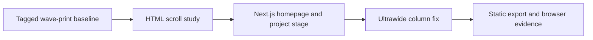

## What

Experiment **002** records the scroll redesign following the closed homepage experiment 001. The opening holds Sagar’s name and the indigo wave. The introduction advances over it. A full-height project stage stays pinned as QuickCall and Misal pass through, then releases into Consulting and Writing.

### Asset inventory

| Material | Durable location |
| --- | --- |
| Homepage composition and responsive styling | [Page](../../../../src/app/(site)/page.tsx) · [Styles](../../../../src/app/(site)/landing.css) |
| Scroll choreography and project illustrations | [WaveOpening](../../../../src/components/WaveOpening.tsx) · [ProjectPrint](../../../../src/components/ProjectPrint.tsx) |
| Artwork and typography served by the site | [Original wave WebP](../../../../public/indigo-curl.webp) · [Editable wave SVG](../../../../public/indigo-curl.svg) · [Literata](../../../../public/fonts/Literata/) |
| SVG provenance | [Trace generator](../../../../scripts/trace-indigo-wave.mjs) · [Original and trace comparison](../assets/wave/source-and-trace.png) |
| Baseline and design exploration | [Baseline captures](../assets/baseline/) · [HTML study](../../../../design/scroll-study.html) · [Study captures and motion spec](../assets/study/) |
| Final browser evidence | [Desktop walkthrough](../assets/walkthrough/1440.png) · [Phone walkthrough](../assets/walkthrough/390.png) · [Full-resolution frames](../assets/walkthrough/) |
| Regression evidence | [User-reported views](../assets/reported/) · [Ultrawide before/after and phone result](../assets/responsive/) |
| Project-local design guidance | [MotionSites](../../../../.agents/skills/motionsites-web-builder/SKILL.md) · [Animation opportunities](../../../../.agents/skills/find-animation-opportunities/SKILL.md) · [Repository instructions](../../../../AGENTS.md) |

## Key Takeaways

- At 2560 CSS pixels, viewport-relative padding squeezed the project into 83 pixels. A grid with 43:57 tracks inside the capped content width gives the article 675 pixels from 1440 through 5120. At 320 pixels the mobile article measures 280 pixels.
- An overflow check alone missed the collapse because the heading wrapped inside its box. The regression test checks the article width and line count.
- The SVG uses six traced ink layers. It simplifies the paper grain. The smaller WebP supplies the homepage hero.

## Current State

Local redesign based on `master` at `3586f53`, tagged `site-v1-baseline`. The baseline tag and redesign checkpoint are local. Experiment 002 has one checkpoint. The motion spec and HTML study document the design intent.

The production build passed. At checkpoint time ten Playwright tests passed against the static export, covering [navigation](../../../../tests/navigation.spec.ts), [project pinning and ultrawide layout](../../../../tests/projects-scroll.spec.ts), [reading progress](../../../../tests/scroll-progress.spec.ts), and [artwork placement](../../../../tests/portrait-placement.spec.ts). Desktop and phone walkthroughs were recaptured after the grid fix. The width sweep covered 320, 390, 800, 801, 1024, 1440, 1920, 2560, 3440, and 5120 CSS pixels.

## Issues

The mobile checks use Chromium emulation. Physical-device browser chrome and Safari behavior still need direct verification. The earlier preview intermittently failed image decoding under concurrent checks. The final walkthrough explicitly decoded the hero image before capturing it.

## Decisions

Keep runtime artwork in `public/`, authored illustrations in `src/components/`, the standalone design study in `design/`, and QA evidence under this experiment. Generated exports can be rebuilt. Store the page portion of the desktop bug report so the browser tabs and bookmarks remain private.

## Inferred Priority

**Inferred:** Review the ultrawide correction and test the pinned sequence on a phone before deciding whether to publish.

## Next

1. From the repo root, run `bash /Users/sagar/.agents/skills/doc/scripts/resume.sh 2` to resume this experiment.
2. Run `npm run build`, then `python3 -m http.server 18847 --bind 127.0.0.1 --directory out` on an available local port.
3. From another shell, run the command below. Open `/#what-i-built` and scroll through both projects in both directions. Compare against the saved full-resolution frames.
4. To regenerate the editable artwork, run `node scripts/trace-indigo-wave.mjs`. The source is `public/indigo-curl.webp`.

```sh
TEST_SITE_URL=http://127.0.0.1:18847 npx playwright test \
  tests/navigation.spec.ts tests/projects-scroll.spec.ts \
  tests/scroll-progress.spec.ts tests/portrait-placement.spec.ts --workers=1
```
