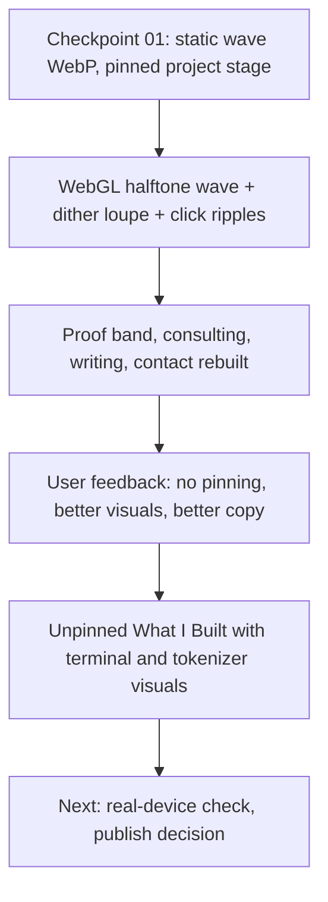

## What

- **Hero**: `src/components/HalftoneField.tsx` reprints `public/indigo-curl.webp` live as rotated halftone dots (WebGL2, mipmap-averaged tone per cell). Mouse opens a 1-bit Bayer dither loupe with riso misregistration; moves leave light ripples; a click sends a strong ring plus an echo that adds ink on bare paper. Ambient swell, auto ripples when idle, coarse-to-fine resolve on load. Scroll (`--travel` from `WaveOpening`) zooms, coarsens and dissolves into dither. The WebP `<Image>` stays underneath as fallback.
- **Motion helpers**: `src/components/Motion.tsx` with `ScrollVar` (`--p` progress, optional `data-step`), `Reveal` (`is-armed`/`is-in`, visible without JS), `CountUp`.
- **Page** `src/app/(site)/page.tsx`: intro words ink in with scroll; (02) proof band with QuickCall numbers from quickcall.dev (100K sessions, ~1.3B tokens) plus Misal 2B+ tokens and People+AI 22 languages; (03) What I Built as normal-flow alternating rows; (04) Consulting rows with metric and halftone hover sweep; (05) Writing with 5 latest posts from `getBlogPosts()` and real tag counts; (06) contact "Bring me the hard part." over a light-on-navy `tide` halftone of the same wave.
- **Project visuals**: `src/components/ProjectVisual.tsx`. QuickCall is a Claude Code terminal mock taken from the quickcall.dev demo. Misal is a tokenizer split of `मला मिसळ खूप आवडते` (graphemes vs 4 words) labelled "Illustrative". `ProjectPrint.tsx` deleted.
- Styles in `src/app/(site)/landing.css`. Evidence screenshots in [assets/halftone](../assets/halftone/).

## Key Takeaways

- Clicking empty paper did nothing visible because ripples only displaced existing dots. Fix: the ripple front adds ink tone and the trough subtracts it (`foam` is a vec2 in the shader).
- Resampling an already-halftoned source makes moiré. Sampling at `log2(cell texels) + lodBias` (0.8 hero, 1.0 tide) averages the source dots away.
- Full-tone dots merging read as a blur. The `dot` cap (1.38 hero, 1.12 tide) keeps gaps in the darkest areas.
- Bayer value 0 printed a speckle grid on paper until the threshold got `+0.01`.
- Global `li { margin-left: 1.5rem }` and `.landing ol { padding: 0 }` override component list styles. Use `.landing .x` specificity.
- `Array.from` on Devanagari splits matras into dotted-circle glyphs. Use `Intl.Segmenter` graphemes.

## Current State

- Branch `master`. Base commit `933ae14` (checkpoint 01). This checkpoint is committed with the redesign.
- Only the hero remains sticky. Project stage pinning and sticky section heads are removed.
- `tests/projects-scroll.spec.ts` rewritten: the section scrolls without pinning at 390 and 1440, there is no status pill, titles stay on one line and visuals keep >50% row width from 1440 to 3440.
- `npm run build` passed. With the static export on port 18847, 10 Playwright tests passed (navigation, projects-scroll, scroll-progress, portrait-placement).
- The user's dev server runs on port 4174.

## Issues

- Verified in headless Chromium only (desktop 1440, phone 390 emulation). Safari/iOS WebGL2 and touch ripples still need a physical device.
- The Misal tokenizer split is hand-made, not real tokenizer output. It is labelled "Illustrative".
- `tests/projects-scroll.spec.ts` had a pre-existing TS error on `offsetHeight`. Fixed with an `HTMLElement` cast.
- `react-grab` CORS error in dev console. It comes from the existing setup and is unrelated.

## Decisions

- Kept the user's wave artwork as the shader source rather than procedural water. The user explicitly likes the wave.
- Replaced halftone project prints with product visuals after the user said the images "suck".
- Removed all pinning except the hero opening, after the user said the sticky behaviour felt inconsistent.
- The CTA avoids repeating "AI" and names agents, language models and evals instead.
- No Claude attribution on commits (user rule, saved to memory).

## Inferred Priority

Inferred: test hero interaction and project visuals on a real iPhone/Android and Safari, then decide whether to publish.

## Next

1. `npm run build && python3 -m http.server 18847 --bind 127.0.0.1 --directory out`
2. `TEST_SITE_URL=http://127.0.0.1:18847 npx playwright test tests/navigation.spec.ts tests/projects-scroll.spec.ts tests/scroll-progress.spec.ts tests/portrait-placement.spec.ts --workers=1`
3. Open on a phone over LAN, then tap the hero and contact waves. Watch frame rate. Lower `cellNarrow` or the DPR cap in `HalftoneField.tsx` if slow.
4. Tune shader feel through `VARIANTS` in `HalftoneField.tsx`: `cell`, `lodBias`, `dot`, `warp`, `lens`. Tune click strength in `onDown`.
