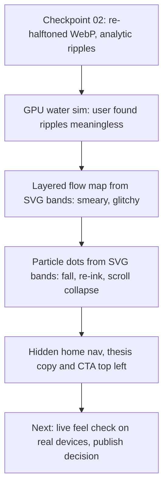

## What

- **Band map:** `scripts/bake-wave-bands.mjs` flattens the 6 nested ink layers of `public/indigo-curl.svg` into `public/indigo-bands.png`. It is 1620px grayscale with 32 palette colours and weighs 414KB. Pixel value / 255 × 6 = band (0 paper to 6 deepest ink).
- **Hero renderer:** `src/components/HalftoneField.tsx` was rewritten as WebGL2 `gl.POINTS` particles.
  - **Layout:** dots sit on a rotated lattice (angle 0.42, cell 6px desktop / 5px phone, ×DPR). Dot radius is `cell·0.5·√tone·1.38`. Tone comes from the band map, downscaled step by step to 300px on a 2D canvas (about one texel per cell, no moiré). Colour is a ramp over the 6 SVG ink colours.
  - **Cursor:** fast pointer moves knock dots near the cursor. Each knocked dot sheds a droplet into a 4000-particle pool, which falls under gravity (1100·dpr px/s²) and fades over 1.25s. The home dot re-inks from scale 0 over 0.75s after a 0.15s pause.
  - **Click:** a 90px burst.
  - **Idle:** spray sheds from light-tone dots in the top 55% (26/s hero, 14/s tide).
  - **Swell:** a sine swell in the vertex shader.
  - **Scroll:** `--travel` from `WaveOpening` drops dots by a per-dot random threshold in the vertex shader. It is reversible and needs no CPU state.
  - **Reduced Motion:** freezes ambient motion. Pointer input still animates for 3s.
- **Fallback:** the hidden WebP `<Image>` shows only when the canvas sets `data-failed`, or through a `<noscript>` style. This fixed the blue-wave flash on refresh.
- **Header:** `src/components/Header.tsx` adds `site-header--intro` on `/` while `scrollY < 0.3·innerHeight`. In `landing.css` the header is fixed over the hero and translated off-screen; it slides in on scroll and on `:focus-within`. The hero is now full `100svh` at `top: 0`.
- **Hero copy:** the CTA pill is removed. `.landing-thesis` sits top left: "Hard problems look like walls until you learn to read them as *waves*." The link "Bring me the hard part" goes to `#contact`. The water hint text is removed.
- **Tests:** `tests/navigation.spec.ts` runs the menu tests on `/blog/` and adds a homepage header reveal test at 390 and 1440.
- Evidence screenshots are in [assets/particles](../assets/particles/).

## Key Takeaways

- The user rejected ripples and smears as meaningless for a breaking wave. Discrete dots that fall like spray read correctly.
- Reduce Motion was on for the user's Mac, which is why "nothing moved". The renderer now always allows motion the visitor causes.
- Carving dots out on knock left an erased trail. Shedding a copy while the home dot re-inks keeps the print whole.
- `max-width: 19ch` on a container uses the container's font size, not the child's. Put `ch` limits on the text element.
- An entrance animation with `fill: both` overrides a scroll-driven `opacity`, so animate the children instead.
- Headless Chromium (ANGLE) holds 120fps with about 30k dots plus the droplet pool at 1440×900.

## Current State

- Branch `master`. Previous commit `531557e`. This checkpoint is committed with the work.
- `npm run build` passed. With the static export on port 18847, 12 Playwright tests passed (navigation incl. new header test, projects-scroll, scroll-progress, portrait-placement).
- The user's dev server runs on port 4174.

## Issues

- The motion feel was checked only through headless screenshots and fps. The user has not yet confirmed the falling dots live.
- Both `indigo-curl.webp` (fallback, preloaded) and `indigo-bands.png` download, about 850KB together. Consider dropping `preload` on the fallback.
- The hero arrow link uses ↗ although it is an in-page jump.

## Decisions

- Kept raw WebGL2 instead of three.js. The point renderer is about 400 lines and adds no dependency.
- The band map comes from the SVG (the user asked that the SVG dots be the base), not from the WebP.
- The nav hides on the home page only. Other pages keep the sticky header.

## Inferred Priority

Inferred: user reviews the live hero feel (spray rate, knock radius, gravity), then a real-phone check, then publish.

## Next

1. `npm run build && python3 -m http.server 18847 --bind 127.0.0.1 --directory out`
2. `TEST_SITE_URL=http://127.0.0.1:18847 npx playwright test tests/navigation.spec.ts tests/projects-scroll.spec.ts tests/scroll-progress.spec.ts tests/portrait-placement.spec.ts --workers=1`
3. Tuning knobs in `HalftoneField.tsx`:
   - `VARIANTS.*.spray` sets the idle spray rate, and `cell` the dot pitch.
   - In `onMove`, `knock(..., 30 * dpr, ..., Math.min(0.7, speed / 1400))` sets the cursor radius and strength. `onDown` sets the click burst (90px).
   - `g = 1100 * dpr` is gravity. `pAge / 1.25` is the droplet life.
   - The re-ink timing is `(age - 0.15) / 0.75`.
4. To regenerate the band map after editing the SVG, run `node scripts/bake-wave-bands.mjs`.
