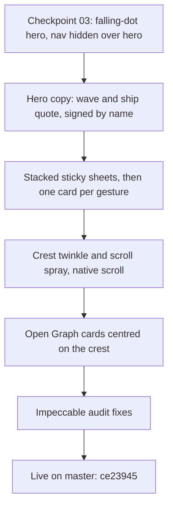

## What

**Hero** (`src/app/(site)/page.tsx`, `src/app/(site)/landing.css`)
- Quote is the headline: "You can’t stop the wave. / But you can build the *ship*." It sits in a `div.mast-quote` blockquote.
- The page's only `h1` is "Sagar Sarkale", right-aligned as a signature in `.mast-sign`, outside any `figure`.
- The CTA reads "Let’s build one for you", with no arrow, and links to `#contact`.
- On phones the quote is sized to fit one sentence per line.

**Wave renderer** (`src/components/HalftoneField.tsx`)
- WebGL2 points sampled from `public/indigo-bands.png`.
- Crest twinkle in the vertex shader. Crest dots are tone 0.05–0.7 in the top ~60% of the canvas. The swell runs 6–18s per cycle. Only about 40% of those dots blink, each roughly every 10–25s.
- Scrolling sheds mid-tone crest dots (`crestDots`) into the droplet pool. The rate is 3 per px of scroll, capped at 200 px per event. Gravity is 650 dpr; each droplet lives 1.8s.
- The wave body no longer collapses on scroll; the `uTravel` uniform is removed.

**Scroll** (`src/components/ScrollStage.tsx`)
- Native scrolling, the way Apple's sites do it. Lenis is uninstalled.
- `.stack` sheets stick under the header. Covered sheets darken through `--cover`; they are not scaled.
- A sliding sheet has rounded corners that flatten as it docks (`--arrive`). Each sheet is at least one screen tall.
- One gesture moves one card. Wheel, trackpad and touch swipes all glide to the next `.snap-point` marker. There are 7 zero-height markers in normal flow.
- Cards taller than the screen stop every 0.85 of a screen height, then at `next + pad - vh` (their bottom meets the screen).
- The opening has no intermediate stops.
- Glide steps use `behavior: 'instant'`, because global `html { scroll-behavior: smooth }` would ease every step.
- `pad` is the header height after scrolling: the measured height, minus 8 while the header is unscrolled.
- Touch: `touchmove` calls preventDefault for vertical swipes, but not inside the mobile menu (`.fixed.inset-0`).

**Other homepage changes**
- **What I Built:** each project is split into `project-intro`, `project-visual` and `project-more` grid areas. Phones stack intro, then demo, then details.
- **Contact close:** "Each of these, I’ve built through. The next one’s yours."
- **Copy:** the "…that ships" phrasing is removed from homepage copy. The About page's personal "the thing I shipped" stays.

**Social share** (`scripts/generate-wave-og.mjs`, `src/app/layout.tsx`)
- **Generated images:**
  - `public/social/home.jpg` (1200x630, JPEG under 300KB)
  - `public/social/square.jpg` (600x600, crest only)
  - `design/og/github-social-preview.png` (1280x640)
- **Crest layout:** the crest anchor `CREST=[0.59,0.555]` sits at the centre of each image. The wave is sized `max(h*1.7, w/2/0.59+8)`.
- **Right side:** a mirrored copy of the SVG fills the right edge, so no artwork edge shows.
- **Text:** a small unsigned quote at bottom left, auto-shrunk so it stays out of Slack's centre square crop.
- **Meta tags:**
  - Title: "Sagar Sarkale — You can’t stop the wave".
  - Description: "The wave is coming either way. Be the one steering through it."
  - Two `og:image` tags: the landscape card first, the square second.
- Card generation runs in a subagent-style script that inlines the fonts (data URLs) and checks that they loaded.

**Impeccable audit** (`docs/experiments/003-impeccable-audit/review/01-review-site-audit.md`, untracked) — all fixed:
- `--fg-muted` is now `#71717a`, contrast 4.63.
- Functional micro-labels are now at least 12px. Tokenizer chips are `#6b4227`, contrast 5.87.
- Reduced motion keeps 150ms opacity and colour fades.
- Page titles are single ("Blog | Sagar Sarkale").
- The `h1` is out of the `figure`.
- Added `text-wrap: pretty` to body paragraphs.
- Added the `--l-*` landing colour tokens.
- Capped the reveal stagger on mobile.
- Monaspace now ships as `.woff2`, with `.woff` as fallback.

**Branch and deploy**
- Back on `master`. `.github/workflows/deploy.yml` triggers on pushes to `master`, and `master` is GitHub's default branch.
- The `github-pages` environment allows only `master`. Never push `main`; this is saved in memory.

Evidence screenshots: [assets/live](../assets/live/).

## Key Takeaways

- The user's "nothing moves" report was Reduce Motion being on. The renderer now always lets user-caused motion play.
- Scaling a covered sticky sheet exposed the section behind it as blue strips and wedges. Shading alone avoids that.
- CSS `scroll-snap` failed on this page: the long hero snapped back to the top. JS paging with flow markers works.
- Sticky elements report their stuck position, so snap targets must be non-sticky markers.
- Slack's current unfurl shows a small square crop from the centre of `og:image`. Composition, not tags, decides that thumbnail.
- The user dislikes copy that smells of AI: "…that ships", and "AI" repeated. They prefer short, emotional lines.

## Current State

- `master` = `origin/master` at `ce23945`, deployed and live on sagarsarkale.com. This checkpoint commit follows it.
- Tests: run with `TEST_SITE_URL=http://127.0.0.1:18847 npx playwright test tests/card-scroll.spec.ts tests/og-meta.spec.ts tests/navigation.spec.ts tests/projects-scroll.spec.ts tests/scroll-progress.spec.ts tests/portrait-placement.spec.ts --workers=1`. All 15 passed.
- Untracked, not this agent's: `.agents/skills/impeccable/`, `.codex-attachments/`, `docs/experiments/003-impeccable-audit/`.
- `origin/main` still exists on GitHub. It contains nothing beyond `master`. Deleting it needs the user's OK.

## Issues

- Nothing has been checked on a real phone or in Safari. Touch paging, WebGL and the crest effects were tested only in Chromium emulation.
- Card paging overrides native momentum on the homepage. Watch for user reports about trapped scrolling or the mobile menu.
- Social caches (Slack, LinkedIn) keep old previews. Use `?v=N` or LinkedIn Post Inspector.
- The GitHub repo social preview must be uploaded by hand (Settings → General → Social preview). There is no API for it.
- `/work` and other pages share the root `og:url`. This predates this work.
- When chaining commands, use the real exit code. `grep | head` masked one failing test, which was deployed and then fixed.

## Decisions

- Native scroll plus position-driven effects instead of Lenis. The user found the eased scroll laggy.
- Paging is enforced on touch too, at the user's explicit request.
- Kept the user's preferred landscape card style. Its composition is centred on the crest; the quote is secondary, at the user's request.
- Social card work was delegated to a subagent at the user's request, then reviewed before deploying.
- No Claude attribution on commits (memory: `no-claude-attribution`). Deploy from `master` only (memory: `deploy-from-master`).

## Inferred Priority

Inferred: test on a real iPhone or Android and in Safari (paging, WebGL, twinkle), then check real Slack and LinkedIn previews of the live URL.

## Next

1. On a phone: open https://sagarsarkale.com, swipe through every card, open and close the menu, and tap the CTA and links.
2. Paste https://sagarsarkale.com/?v=4 into Slack and the LinkedIn Post Inspector to confirm the crest-centred cards.
3. Tuning knobs:
   - **`ScrollStage.tsx`:** glide duration `520 + |dist|*0.25` (max 1000), lock `380ms`, swipe threshold `36px`, inner stop spacing `0.85*vh`.
   - **`HalftoneField.tsx`:** twinkle speeds in the vertex shader, and scroll shed rate `* 3`.
4. To regenerate the cards, run `node scripts/generate-wave-og.mjs`.
5. To deploy: commit on `master`, then `git push origin master`, then `gh run list --limit 1`.
